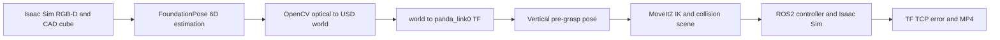

# Vision-Guided Robot Motion Planning | 视觉引导机械臂运动规划

**Isaac Sim 5.1 + NVIDIA FoundationPose + ROS 2 Humble + MoveIt 2 + Franka Panda**

A single-frame RGB-D perception to collision-aware pre-grasp motion demonstration in Isaac Sim. **Not** real-time visual servoing, physical grasping, or a calibrated industrial grasp system.

## Highlights / 核心成果

- Isaac Sim RGB-D image, depth, object mask and camera intrinsics exported to FoundationPose.
- NVIDIA FoundationPose official inference with CAD mesh, image-space overlay and camera-to-world conversion.
- MoveIt2 IK, collision scene, motion planning, ROS2 execution and TCP validation.
- A real integration error was fixed: `world -> panda_link0` static TF used to be **(0, −0.64, 0)** while Isaac Sim actually loaded Franka at **(0, 0, 0)**.

### Reported single-scene measurements (not an aggregate benchmark)

| Metric | Result |
|---|---:|
| Object position error against simulated GT | 1.41 mm |
| Planned motion trajectory points | 77 |
| MoveIt2 execution status | SUCCESS (error code 1) |
| Approximate tool-center position error | 6.86 mm |
| Downward tool-axis angular error | 0.77° |
| Video | 17.1 s verified source video (not included in handoff) |

These values were measured in the source AutoDL setup. The TCP uses a **temporary 58.4 mm local +Z offset from `panda_hand`**, not a calibrated grasp-center reference.

## Architecture / 系统架构

## 🎬 Demo | 演示视频

Franka Panda visual-guided pregrasp demonstration using Isaac Sim, FoundationPose, ROS2, and MoveIt2.

[▶ Watch the Robot Motion Demo](assets/demo.mp4)

> This demo demonstrates single-frame vision-guided pregrasp positioning, not physical object grasping or real-time visual servoing.

## Reproduction / 复现

**Read [docs/reproduction.md](docs/reproduction.md) first.** This is a source-derived reproduction guide for the recorded AutoDL setup; it is **not a container or fully clean-machine verified installer**. The ROS workspace and pretrained FoundationPose weights must be acquired independently. The upstream FoundationPose patch used during the original build is documented.

1. Follow [docs/environment.md](docs/environment.md) to provision Isaac Sim 5.1, ROS Humble/MoveIt2 and FoundationPose.
2. Set `export ROBOT_PROJECT_ROOT=/path/to/this/repository` and prepare third-party workspaces according to the guide.
3. Launch Isaac Sim and the patched MoveIt2 headless launch in **separate terminals**.
4. Run `bash scripts/prepare_target.sh` in a terminal with NVIDIA FoundationPose dependencies installed; input data must exist.
5. Run `bash scripts/plan_only.sh` in a ROS-sourced terminal; only then deliberately run the execution script.
6. Validate TCP with `/usr/bin/python3 planning/check_vertical_tcp.py`.

## Project layout

- `simulation/`: Isaac Sim simulated Panda, cameras, red cube and ROS2 bridge
- `vision/`: FoundationPose, camera-world transform and target generation
- `planning/`: MoveIt2 collision scene, IK planning, deliberate execution and TCP check
- `scripts/`: helper commands and reproducibility safeguards
- `configs/`: source snapshot of the corrected headless launch
- `examples/`: sanitized sample numeric result and metadata; *not* complete RGB-D input
- `docs/`: environment, step-by-step repro, troubleshooting and interview notes
- `experiments/`: honest single-trial report + blank multi-trial template

## Limitations and credits

- Source scripts still depend on upstream proprietary/externally licensed Isaac Sim assets and independently downloaded FoundationPose weights.
- Camera extrinsics in the original experiment were reconstructed from fixed camera placement in the simulation script; moving the camera requires matching the configuration or reading live extrinsics.
- The target is a pre-grasp clearance waypoint, not object contact, pick-and-place or closed-loop tracking.
- Thanks to [NVIDIA FoundationPose](https://github.com/NVlabs/FoundationPose), [NVIDIA Isaac Sim](https://developer.nvidia.com/isaac/sim) and ROS2/MoveIt2 communities. Vendor repositories and model files are not redistributed here. Review each upstream project's license before use.
