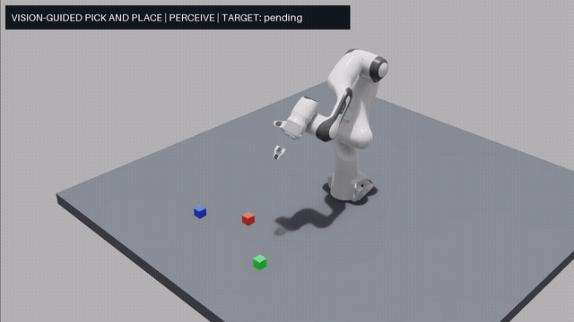
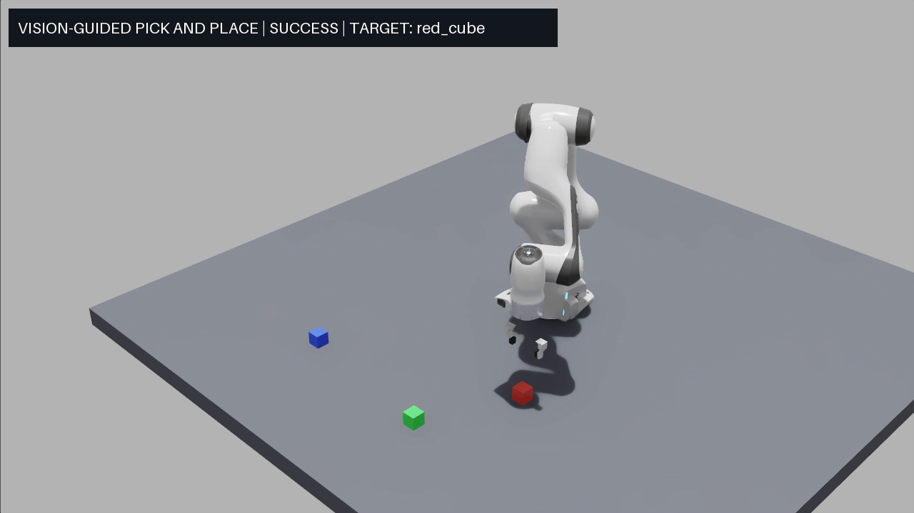
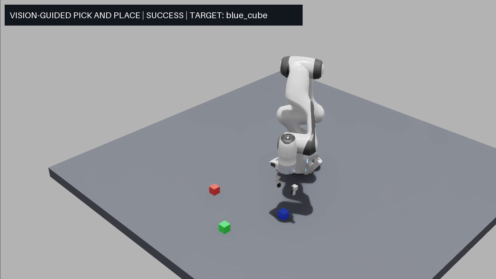
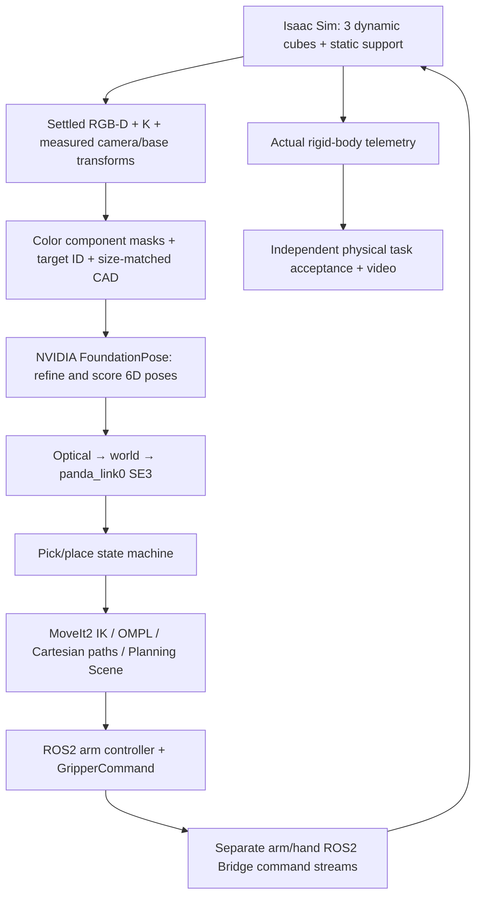

# Multi-Object Vision-Guided Robotic Pick and Place

Isaac Sim 5.1 · NVIDIA FoundationPose · ROS 2 Humble · MoveIt 2 · Franka Panda

## 1. Project Overview

A reproducible integration project that selects one known-color cube from a three-object scene, estimates its 6D pose from a single RGB-D capture, and performs physics-based grasping, lifting, transport, placement and retreat in Isaac Sim. The original 120 mm pre-grasp pipeline remains available.

The contribution is perception/geometry/planning/control integration and independent task evaluation. FoundationPose, robot models, physics and planning libraries are upstream dependencies, not original model implementations. Validation is **simulation only**.

## 2. Demonstration



Actual red-target run, shown at 4× speed. The three full-resolution H.264 videos are prepared as Release assets; **their upload is pending GitHub authentication**. No unavailable download link is presented as live. See [video manifest and publication status](docs/DEMONSTRATION.md).

| Red selected | Blue selected | Green selected |
|---|---|---|
|  |  |  |

The existing [120 mm pre-grasp video](assets/demo.mp4) is retained as a historical demonstration; its measurements are separate from physical pick-and-place results.

## 3. System Architecture



Perception is single-frame and file-based. Physical telemetry monitors execution; this is not continuous visual servoing.

## 4. Technical Stack

- Isaac Sim **5.1.0.0**, Franka Panda, RGB-D camera and PhysX contact simulation.
- ROS 2 Humble; observed MoveIt `move_group` **2.5.10**, OMPL **1.7.0**, ros2_controllers **2.54.1**.
- Official FoundationPose pretrained Refiner/Scorer; PyTorch **2.5.1+cu118**, torchvision **0.20.1+cu118**, PyTorch3D **0.7.9**, nvdiffrast **0.4.0**.
- OpenCV color masks, NumPy SE(3), trimesh CAD boxes, FFmpeg H.264 recording.

See [environment and dependency versions](docs/environment.md), [machine-readable observations](docs/dependencies.json), and [third-party notices](THIRD_PARTY_NOTICES.md). Exact original FoundationPose and Isaac ROS workspace Git revisions are unknown; source fingerprints are recorded instead of invented commit IDs.

## 5. Multi-Object Target Selection

`vision/select_targets.py::color_mask` uses dominant RGB channels and connected components. It rejects missing/small masks and ambiguous same-color components. Three distinct IDs (`red_cube`, `blue_cube`, `green_cube`) share 40 mm cube geometry; each has its own mask and CAD input.

**This is known-color target selection, not open-vocabulary detection or natural-language grounding.** All three poses populate collision obstacles; only the selected ID becomes a grasp task.

## 6. 6D Pose Estimation

`FoundationPose.register(iteration=5)` consumes RGB, metric depth, camera intrinsics, instance mask and the matching CAD mesh. Official pretrained networks refine and score candidate poses. No retraining is required. Simulation object truth is not supplied as an estimated pose or an inference input.

Using `T_A_B` to map coordinates from B to A:

```text
T_world_object = T_world_camera_optical @ T_camera_object
T_base_object  = inverse(T_world_base) @ T_world_object
```

The observation camera exports ROS optical axes (X right, Y down, Z forward) and wxyz quaternions. The full measured base transform is captured from the actual scene; `scene_frames.py` is shared with launch code. No historical fixed base-offset correction is applied.

## 7. Motion Planning and Grasp Control

`planning/pick_place_controller.py` uses MoveIt IK and OMPL joint-space planning for pre-grasp/transfer. Short approach, lift, descent and retreat motions use collision-aware Cartesian paths at 5 mm resolution; fractions below 0.999 are rejected.

The measured USD `panda_hand/tool_center` is **103.4 mm** along hand +Z. Targets compensate `p_hand = p_tcp - R_hand @ t_hand_tcp`; the old 58.4 mm temporary pre-grasp TCP is not used for physical grasping. The cube policy is fixed top-down, not general grasp synthesis.

`GripperCommand → ros2_control → isaac_gripper_commands → ROS2 Bridge` drives the first finger; the second follows the USD mimic constraint. The arm keeps a separate `isaac_joint_commands` stream. Both actual finger positions are checked. The drive's force limit is not a force sensor or a calibrated force-control loop.

## 8. Physics-Based Pick and Place

Three independent **40 mm / 50 g** cubes have dynamic rigid bodies, colliders, mass, friction and gravity response. A static physical collider supports them. Metadata records actual settled/capture poses, with geometry size shared by CAD, masks, projection and planning collision boxes.

```text
INIT → PERCEIVE → SELECT → OPEN → PREGRASP → APPROACH → CLOSE
→ TEST_LIFT → LIFT → TRANSFER → PLACE → RELEASE → RETREAT → VERIFY → SUCCESS
```

Failures enter `FAILED` with reason and stage, bounded timeouts and cancellation of the current action. There are no unbounded retries. Allowed collisions are limited to necessary target/finger/support pairs. Other objects remain collision obstacles. A MoveIt `AttachedCollisionObject` updates planning only: **the Isaac object is neither welded to the hand nor moved by per-frame pose writes**.

Independent acceptance uses actual rigid-body telemetry: lift ≥35 mm, holding observation ≥2 s, relative translation slip ≤12 mm, relative rotation ≤0.3 rad, final planar error ≤15 mm, supported/stable final pose, hand/object separation after release, and non-target displacement ≤10 mm. See `evaluate_pick_place.py` and [detailed implementation](docs/MULTI_OBJECT_PICK_PLACE.md).

## 9. Experimental Results

Three manually inspected, same-runtime-version examples, each starting with all three objects present and placing the selected object at **(0.40, 0.25) m in panda_link0**:

| Target / run | FP position error | Placement XY error | Max relative slip | State-machine time | Full orchestration |
|---|---:|---:|---:|---:|---:|
| Red / `multi_red_016` | 0.49 mm | 1.21 mm | 0.34 mm | 63.31 s | 116.35 s |
| Blue / `multi_blue_015` | 0.11 mm | 1.22 mm | 1.65 mm | 74.20 s | 126.81 s |
| Green / `multi_green_017` | 0.85 mm | 3.26 mm | 1.36 mm | 67.74 s | 119.91 s |

All three passed grasp, transport, placement and independent physical checks. **Three successful examples do not establish a statistically meaningful 100% success rate.** Raw-metric records and failed examples are in [experiments](experiments/README.md).

Failures are retained: green 011 slipped **14.6 mm** during TEST_LIFT; green 012 lifted successfully but transfer to **(0.40, -0.30)** produced **14.78 mm TCP error**, exceeding the unchanged 12 mm guard. That placement point is not validated as reliable.

## 10. Installation and Reproduction

Use Linux with a compatible NVIDIA GPU/driver, separately installed Isaac Sim and FoundationPose environments, ROS2 Humble/MoveIt2, FFmpeg, and the built Isaac ROS workspace. No environments, weights or vendor repositories are distributed here. Follow [dependency setup](docs/environment.md), then:

```bash
# From the cloned repository; edit the dependency paths in your private .env.
cp .env.example .env
# Edit .env before sourcing it.
set -a
source .env
set +a
python3 -B planning/run_pick_place.py \
  --target red_cube --place-x 0.40 --place-y 0.25 --record
```

This starts the required simulated pipeline in isolated ROS domain 47 and creates a fresh experiment directory. Existing simulation/control processes cause a refusal; only processes created by this run are cleaned up. Default global timeout is 1000 seconds. Do not run it alongside an existing simulation or on real hardware.

CPU-only checks, from a Python environment with the small image/geometry dependencies:

```bash
python3 -B -m unittest discover -s tests -p 'test_*.py' -v
```

No GPU/ROS process is started by these tests. Optional installed-USD/camera checks skip when unavailable. Detailed new and historical pre-grasp commands are in [reproduction](docs/reproduction.md).

The accepted AutoDL runtime is frozen separately. Publication copies retain byte-identical physics, perception, geometry, grasp/state-machine and evaluation sources; only deployment path/configuration handling and portable tests are adapted. **This publication tree has CPU checks, not a fresh GPU end-to-end validation.** See [accepted-core hashes](docs/ACCEPTED_CORE_SHA256.json) and [publication validation](docs/PUBLICATION_VALIDATION.md).

## 11. Known Limitations

- Known distinct colors and cubes; no open-vocabulary detector, SAM, arbitrary shapes, or general grasp generation.
- One selected object per reset; no continuous multi-object clearing, visual servoing or physical robot validation.
- Limited tested initial conditions and placement workspace; contact jitter and tracking errors can cause honest failures.
- Simulator truth is used for evaluation/safety gates and restoring the planning object after release; grasp motion targets come from perception, not truth.
- Original dependency source commits were not recorded; fingerprints and a small upstream dtype patch are documented. A fresh-machine installer is not claimed.
- Full videos/evidence Release upload is pending authentication; the repository includes actual lightweight animation, stills and compact numeric evidence.

## 12. References and Acknowledgments

- [NVIDIA FoundationPose](https://github.com/NVlabs/FoundationPose): pretrained 6D pose estimator, Refiner and Scorer.
- [Isaac Sim](https://github.com/isaac-sim/IsaacSim) and [IsaacSim ROS workspaces](https://github.com/isaac-sim/IsaacSim-ros_workspaces): simulation, assets and ROS integration.
- [MoveIt2](https://github.com/moveit/moveit2), [OMPL](https://ompl.kavrakilab.org/), [ros2_control](https://control.ros.org/humble/): planning/control infrastructure.
- [Third-party versions, licenses and local patch](THIRD_PARTY_NOTICES.md).

For code-level interview preparation, read [INTERVIEW_CODE_GUIDE.md](docs/INTERVIEW_CODE_GUIDE.md).
